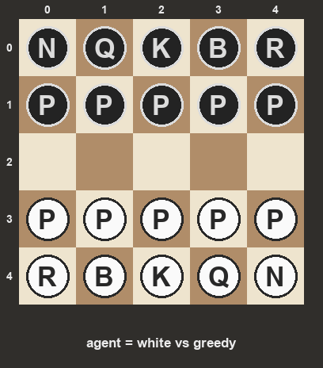

# chess-agent

A game-playing agent for **Chess Fragments**, a chess variant on a 5x5 board with a custom piece (the "Right") and queen-only pawn promotion. The agent uses alpha-beta minimax with iterative deepening, and the repo includes its own rules engine, so you can clone it and play games with public dependencies only.



> The agent (`agent.py`) was my coursework for the University of Southampton AI module (COMP2321, 2025). The module's own game framework isn't included. This repo ships an independent reimplementation of the rules (`fragments/`) instead, checked move for move against the official framework (see [Rules engine](#rules-engine)).

## Chess Fragments in brief

The standard starting position (`sample0`). Upper case is white, lower case is black, `R` is the Right:

```
     0 1 2 3 4
   +-----------+
 0 | n q k b r |   black
 1 | p p p p p |
 2 | . . . . . |
 3 | P P P P P |
 4 | R B K Q N |   white (moves first)
   +-----------+
```

`sample1` uses the same pawns with the back rows `r q k n b` / `B N K Q R`.

- **Pieces.** King, queen, bishop and knight move as in normal chess. The **Right** moves like a rook *or* a knight, a piece also known as a chancellor.
- **Pawns** move one square forward, or two from their starting row if both squares are empty, and capture diagonally. En passant applies. Pawns promote **only to a queen** when they reach the far row.
- **No castling.** There are no rooks.
- **Check works as normal.** You can't make a move that leaves your own king attacked.
- **Game end**, checked after every move:
  - **Checkmate.** The side to move loses.
  - **No legal moves** without being in check also **loses**. Unlike normal chess, stalemate isn't a draw.
  - **Only the two kings left** is a draw.
  - **The same position for the fifth time** (same pieces and same side to move) is a draw.
  - **A side with no king** loses. This can't happen through legal play, but the check is there.

## How the agent searches

- **Minimax with alpha-beta pruning**, written as separate max and min functions. Scores are always from the root player's point of view.
- **Iterative deepening** from depth 1 upwards inside the per-move time limit, so there is always a move from the last finished depth. It stops early once it finds a forced mate.
- **Aspiration windows.** From depth 3 it searches a ±0.5 window around the previous depth's score and re-searches with a full window if the result falls outside.
- **Transposition table** keyed by a position hash. It stores the depth plus an exact, lower or upper bound, and is used for cutoffs.
- **Principal variation table.** The best move found at each position is tried first in the next iteration.
- **Move ordering:** PV move first, then captures by MVV-LVA (most valuable victim, least valuable attacker), then promotions. Early in the game it penalises moving the knight, Right, king and queen. It also rewards moves towards the centre and pawn advances.
- **Null-move pruning** at depth 3 and above, when the material balance allows it and the side to move isn't in check.
- **Late-move reductions.** Quiet moves after the first four are searched one ply shallower. They're re-searched at full depth if they turn out better than expected.
- **Mate scores.** Having no legal move scores ±(10000 − ply), so the agent prefers the fastest win and the slowest loss.
- **Make/unmake** on the board for ordinary moves. Promotions and en passant go through a board clone.
- **Evaluation:** material (pawn 1, knight 3, bishop 3, queen 9, Right 9) is updated incrementally move by move, plus small positional terms for centre control, pawn advancement and king distance from the edge.

## Quickstart

You need **Python 3.11 or 3.12. Python 3.13 or newer won't work.** The rules engine is built on [ChessMaker](https://github.com/WolfDWyc/ChessMaker) 0.5.0, which defines `Piece.name` with `@classmethod` stacked on `@property`. Python 3.13 removed support for that, so ChessMaker fails on its first piece-name lookup (`AttributeError: 'property' object has no attribute 'lower'`).

```bash
git clone https://github.com/Maheer1001/chess-agent.git
cd chess-agent
py -3.12 -m venv .venv                 # or: uv venv --python 3.12 .venv
source .venv/Scripts/activate          # PowerShell: .venv\Scripts\Activate.ps1 ; macOS/Linux: source .venv/bin/activate
python -m pip install -r requirements.txt
python play.py --white agent --black random --show
```

No API keys or coursework files are needed.

## Playing games: `play.py`

```bash
python play.py --white agent --black random --games 1 --show       # watch one game
python play.py --white greedy --black agent --games 10 --time 0.5   # 10 games, 0.5 s per agent move
python play.py --white agent --black agent --start sample1 --show  # self-play
```

| Option | Meaning |
|---|---|
| `--white`, `--black` | `agent`, `random` (uniform random legal move) or `greedy` (biggest immediate material gain, random tie-break) |
| `--games N` | number of games (default 1) |
| `--seed S` | seed for the opponents' random choices |
| `--time T` | agent thinking time per move in seconds (default 1.0) |
| `--start` | `sample0`, `sample1` or `alternate` (default, switches every game) |
| `--max-plies` | the game is drawn after this many plies (default 200) |
| `--show` | print the board after every ply, with the agent's search depth, score (in pawns, from its own side; `mate` = forced mate found), nodes and time |
| `--record FILE` | save the games as JSON (used by `tools/render_gif.py`) |

Example `--show` output:

```
ply   9  white (agent): Q 1,2 -> 1,1   [depth 2, score mate, 52 nodes, 0.10s]
     0 1 2 3 4
   +-----------+
 0 | n . k b r |
 1 | . Q p . p |
 2 | p . P . . |
 3 | P P . p P |
 4 | R B . K N |
   +-----------+
=== Game ended: Checkmate - black loses ===
```

Each agent gets a fresh copy of `agent.py`, so no state carries over between games or between the two sides in self-play. Like the coursework runner, a player that returns no move loses the game, and `play.py` reports this as `Resigned`.

## Results

The agent played 20 games per opponent per colour (160 games in total), with 0.5 s per move, alternating `sample0` and `sample1`. Wins, draws and losses are from the agent's side.

| Opponent | Agent plays | W / D / L | Avg depth | Nodes/s |
|---|---|---:|---:|---:|
| random | white | 20 / 0 / 0 | 2.89 | 546 |
| random | black | 20 / 0 / 0 | 2.86 | 520 |
| greedy | white | 20 / 0 / 0 | 3.20 | 707 |
| greedy | black | 19 / 1 / 0 | 2.97 | 596 |
| **total** | | **79 / 1 / 0** | | |

To reproduce:

```bash
python tools/benchmark.py --games 20 --time 0.5 --seed 1
```

Measured on a desktop PC (Windows 10, Python 3.12). Search speed is low, a few hundred nodes per second, because ChessMaker checks legality by cloning the board for every candidate move. The search is time-limited, so a rerun gives slightly different games.

The agent also wins its full game in the official coursework runner (`Checkmate - black loses`) with the official 14 s per-move budget, taking about 11 s per move.

## Rules engine

`fragments/` is a small package on top of ChessMaker:

| Module | Contents |
|---|---|
| `pieces.py` | the `Right` piece and `queen_pawn()` |
| `setup.py` | `WHITE`/`BLACK`, the `sample0`/`sample1` layouts, `new_board(layout, to_move)` for any position written as five row strings |
| `rules.py` | `static_result(board)` and `ResultTracker` (adds fivefold repetition), implementing the end-of-game rules above |
| `board_utils.py` | `list_legal_moves_for(board, player)` and `copy_piece_move(board, piece, move)`, with the same signatures and return values as the coursework helpers `agent.py` was written against, plus ASCII printing |
| `opponents.py` | the random and greedy baselines |

`agent.py` tries `extension.board_utils` first, so it still runs unchanged inside the official coursework framework. If that isn't installed, it uses `fragments.board_utils`.

**Differential testing.** `tools/difftest.py` runs only when the official framework files are present locally. They aren't in this repo. The script plays random games from both starting positions on two boards at once, one built by the official framework and one by `fragments`, and after every move compares the full ordered list of legal moves (piece, origin, destination, captures, promotion and en passant flags), the game result, and `copy_piece_move`. Some games prefer captures to reach endgames, and others shuffle pieces back and forth to trigger repetition draws. Latest run, `python tools/difftest.py --playouts 600 --max-plies 200 --seed 2026`:

| Playouts | Positions compared | Legal moves compared | Results compared | Mismatches |
|---:|---:|---:|---:|---:|
| 600 | 31,408 | 285,587 | 31,408 | **0** |

These games ended in 182 repetition draws, 180 kings-only draws, 141 checkmates and 93 no-legal-move losses. 4 reached the 200-ply limit.

There is one deliberate difference. In positions you build yourself with `new_board(rows)`, pawns standing off their starting row count as already moved, so they don't get the two-square first move. The official framework only ever starts from the two sample positions, where every pawn is on its starting row, so the two engines agree there.

## Tests

```bash
python -m pytest
```

35 tests:

- `tests/test_rules.py` checks the legal moves of every piece type, in both sample positions and in hand-built positions, with expected sets worked out by hand. It also covers the pawn double step, captures, en passant and queen-only promotion for both colours, pins and escaping check, every game-result rule including fivefold repetition, and the two helper functions.
- `tests/test_agent.py` covers five win-in-one positions, including a smothered mate, a Right back-row mate, a mate by promotion and one with black to move. The agent must find the winning move. It also checks the search stats and plays one full game.

## Tools

| Script | Purpose |
|---|---|
| `tools/benchmark.py` | runs the agent against each opponent as both colours and prints the results table |
| `tools/difftest.py` | compares `fragments` against the official framework (needs the coursework files locally) |
| `tools/render_gif.py` | turns a `play.py --record` file into an animated GIF |

The GIF above was made with:

```bash
python play.py --white agent --black greedy --games 4 --time 1 --seed 4 --start sample0 --record game.json
python tools/render_gif.py game.json media/agent_win.gif --game 1
```

The agent's search is time-limited, so replaying the same seed can produce a different game.

## Credits & licence

- **ChessMaker** by [WolfDWyc](https://github.com/WolfDWyc/ChessMaker) provides the board, the standard pieces, check detection and the event system. It is licensed under **AGPL-3.0** and installed from PyPI; none of its code is copied here.
- **Chess Fragments and the original game framework** (`extension/`, `samples.py`, `opponent.py`, `test_fullgame.py`) were written by the **COMP2321 teaching team** at the University of Southampton. That framework is **not included** in this repo. `fragments/` is an independent reimplementation of the rules, written from the game's behaviour and checked against the official framework with the differential test above.
- **The agent** (`agent.py`), the rules engine, the runner, the tests and the tools are by **Maheer** ([@Maheer1001](https://github.com/Maheer1001)).
